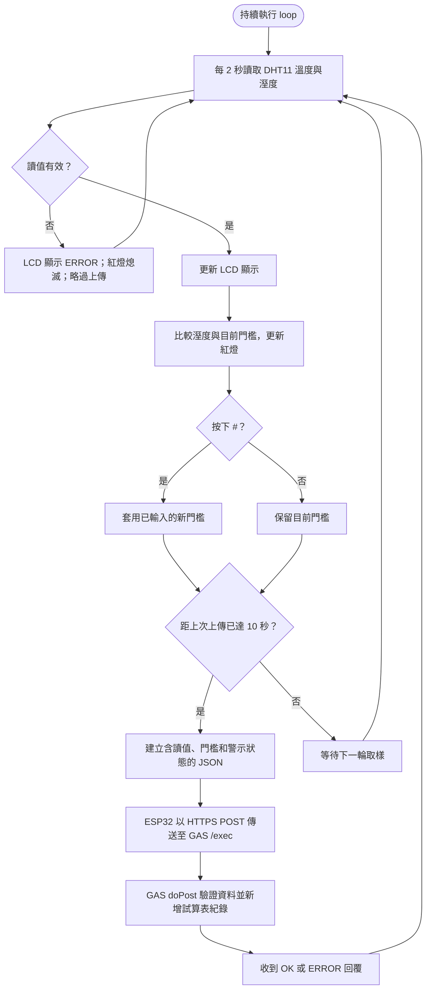

以下是一份虛構的技術報告示例。藍字是可替換的範例內容，請改成自己的設計與實測紀錄。

[線上檢視 HackMD 技術報告範例](https://hackmd.io/0osYcsatT3u9vyzAQNACgQ)

<a href="/downloads/robotics-final-report-template.docx" download="期末專案技術報告範本.docx">下載空白 Word 範本（.docx）</a>

## 封面

- **專案名稱**　<span style="color: #154d87;">桌面溼度提醒器</span>
- **班級、座號、姓名**　（請列出所有組員姓名）
- **實作日期**　<span style="color: #154d87;">11/18、12/02、12/16</span>
- **開發平台**　<span style="color: #154d87;">ESP32-S3 N16R8、Arduino IDE、Google Apps Script、Google 試算表</span>

## 壹、專案動機與目標

### 一、專案動機

*請說明誰在什麼情境遇到什麼問題，以及為什麼想用微控制器解決。可以從一次具體的觀察寫起。*

> **範例文字**　<span style="color: #154d87;">我們平常把紙本筆記疊放在靠窗的書桌上。下雨後整理桌面時，有幾張靠窗的講義摸起來偏潮，紙角也有點捲曲。平常寫作業時，我們不會一直留意桌邊的溼度，所以想用 ESP32-S3 定期讀取桌面附近的相對溼度。溼度偏高時亮起紅燈，提醒我們檢查窗邊狀況，或把講義移到別處。我們也想比較雨前雨後的溼度，並記下當時的警示門檻，方便回頭解讀燈號。</span>

### 二、專案目標

*請條列 2～3 項預計達成的功能。寫清楚裝置會讀取什麼、在什麼條件下做出什麼反應，以及你會怎麼確認它有做到。*

1. <span style="color: #154d87;">用 ESP32-S3 和 DHT11 每 2 秒讀取一次相對溼度，將有效讀值顯示在 LCD1602 上，方便觀察桌面附近的變化。</span>
2. <span style="color: #154d87;">用 4×3 矩陣鍵盤輸入溼度門檻，按 # 確認。預設門檻為 70% RH。有效讀值達到或超過門檻時亮紅燈，低於門檻就熄燈。保持讀值相近，切換門檻來驗證燈號。</span>
3. <span style="color: #154d87;">透過 Wi-Fi 將有效讀值、當時門檻和警示狀態送到 GAS，由 GAS 加上收件時間並寫入 Google 試算表。調整門檻後，比對 LCD、燈號與試算表最後一列。</span>

### 功能驗收摘要

| 功能 | 觸發條件或操作 | 預期反應與驗收方式 |
| --- | --- | --- |
| <span style="color: #154d87;">核心功能</span> | <span style="color: #154d87;">有效讀值達到目前門檻</span> | <span style="color: #154d87;">LCD 顯示讀值與門檻，紅燈亮。低於門檻時紅燈熄滅。</span> |
| <span style="color: #154d87;">輔助功能一：門檻調整</span> | <span style="color: #154d87;">用鍵盤輸入新門檻並按 # 確認</span> | <span style="color: #154d87;">紅燈依新門檻更新；下一筆上傳包含新門檻和當時的警示狀態。</span> |
| <span style="color: #154d87;">輔助功能二：GAS 串接</span> | <span style="color: #154d87;">有效讀值到達 10 秒上傳時間</span> | <span style="color: #154d87;">GAS 收到 JSON、驗證欄位、在試算表新增一列，並回覆 OK；以試算表的新資料列和 ESP32 的回覆訊息驗收。</span> |

## 貳、硬體與接線

| 零件或模組 | 型號 | 數量 | 用途 |
| --- | --- | --- | --- |
| <span style="color: #154d87;">開發板</span> | <span style="color: #154d87;">ESP32-S3 N16R8</span> | <span style="color: #154d87;">1</span> | <span style="color: #154d87;">讀取資料與控制輸出</span> |
| <span style="color: #154d87;">感測器</span> | <span style="color: #154d87;">DHT11 模組</span> | <span style="color: #154d87;">1</span> | <span style="color: #154d87;">讀取相對溼度</span> |
| <span style="color: #154d87;">顯示器</span> | <span style="color: #154d87;">LCD1602 I2C</span> | <span style="color: #154d87;">1</span> | <span style="color: #154d87;">顯示讀值或錯誤</span> |
| <span style="color: #154d87;">紅色 LED 與電阻</span> | <span style="color: #154d87;">紅色 LED、330 Ω</span> | <span style="color: #154d87;">各 1</span> | <span style="color: #154d87;">溼度提醒與限流</span> |
| <span style="color: #154d87;">矩陣鍵盤</span> | <span style="color: #154d87;">4×3 矩陣鍵盤</span> | <span style="color: #154d87;">1</span> | <span style="color: #154d87;">輸入並確認溼度門檻</span> |

| ESP32-S3 腳位 | 模組與引腳 | 用途或接線備註 |
| --- | --- | --- |
| <span style="color: #154d87;">GPIO 10、3V3、GND</span> | <span style="color: #154d87;">DHT11 的 DATA、VCC、GND</span> | <span style="color: #154d87;">使用支援 3.3 V 的模組</span> |
| <span style="color: #154d87;">GPIO 8、GPIO 9、GND</span> | <span style="color: #154d87;">LCD 的 SDA、SCL、GND</span> | <span style="color: #154d87;">供電與電位轉換依第 8 章接法</span> |
| <span style="color: #154d87;">GPIO 19、GND</span> | <span style="color: #154d87;">紅色 LED 的正極、負極</span> | <span style="color: #154d87;">正極串接 330 Ω 電阻</span> |
| <span style="color: #154d87;">GPIO 4、5、6、7／GPIO 15、16、17</span> | <span style="color: #154d87;">鍵盤 R1～R4／C1～C3</span> | <span style="color: #154d87;">依第 4 章掃描矩陣</span> |

### 接線圖範例

這份範例用電路繪製工具呈現元件與 GPIO 的連接方式。自己的報告可以用電路繪製工具畫出接線，也可以直接拍攝實體電路；請讓照片看得清楚，並在圖上標註 ESP32、感測器、LCD、LED、電阻和矩陣鍵盤。


> 📸 **請在此處貼上你的實體電路接線照片，並於照片上標註關鍵組件。**

<span style="color: #154d87;">本例的接線為：DHT11 DATA → GPIO 10；LCD SDA／SCL → GPIO 8／9；GPIO 19 → 330 Ω 電阻 → LED 正極，LED 負極 → GND；鍵盤行腳 → GPIO 4～7，列腳 → GPIO 15～17。需要電源的模組共地。</span>

## 參、程式怎麼運作

### 系統流程圖

以下流程圖以 HackMD 支援的 Mermaid 語法繪製。有效讀值才會更新警示並排入 GAS 紀錄；讀值失敗時顯示錯誤、熄燈，並略過該筆上傳。


將下列 Mermaid 程式碼貼到 HackMD，使用 Mermaid 圖表區塊即可產生同一流程圖。方框代表處理步驟，菱形代表需要判斷的條件，箭頭表示執行方向。



**簡易製作步驟**

1. <span style="color: #154d87;">在 HackMD 新增 Mermaid 區塊，第一行輸入 `flowchart TD`（由上往下排列）。</span>
2. <span style="color: #154d87;">以 `A[處理步驟]` 寫方框，以 `B{判斷條件？}` 寫菱形；每個節點使用不同代號。</span>
3. <span style="color: #154d87;">用 `A --> B` 連接節點；需要標示判斷結果時用 `B -- 是 --> C`。</span>
4. <span style="color: #154d87;">觀察預覽是否有節點或連線重疊，調整節點順序後再匯出圖檔或保留可編輯的 Mermaid 程式碼。</span>

### 核心程式與 GAS 通訊

<span style="color: #154d87;">先檢查感測值，再用同一個 `alertOn` 控制紅燈並記錄警示狀態。感測器讀值失敗時不要拿錯誤值做比較，也不要把該筆資料送到 GAS。</span>

```cpp
if (isnan(temperature) || isnan(humidity)) {
  lcd.clear();
  lcd.print("ERROR");
  digitalWrite(ledPin, LOW);
  return;  // 讀值失敗，略過本次上傳
}

const bool alertOn = humidity >= humidityLimit;
digitalWrite(ledPin, alertOn ? HIGH : LOW);
showReading(temperature, humidity, humidityLimit);
```

<span style="color: #154d87;">ESP32 先連上 Wi-Fi、完成網路校時，再透過 HTTPS 將 JSON POST 到部署好的 GAS 網頁應用程式 `/exec` 網址。每 10 秒送出一筆有效讀值；實際專案可沿用第 10 章的 `sendReading()`，其中包含 Google 憑證驗證、POST、GAS 重新導向處理和回覆檢查。</span>

```cpp
// 放在全域區域；實際程式也要在 setup() 初始化 Wi-Fi 與 GAS 網址
unsigned long lastUploadMs = 0;

// 到達上傳時間，而且這次感測值有效時才呼叫
if (validReading && now - lastUploadMs >= 10000) {
  lastUploadMs = now;
  const bool alertOn = humidity >= humidityLimit;
  const bool sent = sendReading(temperature, humidity,
                                humidityLimit, alertOn);
  Serial.println(sent ? "GAS: OK" : "GAS: ERROR");
}
```

<span style="color: #154d87;">`validReading` 是本次 DHT11 讀值檢查結果，`now` 是目前的 `millis()` 時間；`lastUploadMs` 記錄上次傳送時間。這是整合位置的程式片段，需放在已讀取有效資料的 `loop()` 中。`sendReading()` 將資料組成 JSON，加入 `Content-Type: application/json` 標頭後呼叫 `HTTPClient::POST()`。門檻與警示狀態要和讀值一起送出，這樣試算表才能保留當時的判斷條件。</span>

```json
{"temperature":25.0,"humidity":72.0,"humidityLimit":70,"alertOn":true}
```

<span style="color: #154d87;">GAS 的 `doPost(e)` 接收 ESP32 傳來的 JSON，檢查欄位和數值，再把收件時間、溫度、溼度、門檻與警示狀態新增到試算表。以下是接收端的核心範例：</span>

```javascript
function doPost(e) {
  const reply = (message) => ContentService.createTextOutput(message);
  let reading;
  try {
    reading = JSON.parse(e.postData.contents);
  } catch (error) {
    return reply('ERROR: invalid JSON');
  }

  if (!reading || !Number.isFinite(reading.temperature) ||
      !Number.isFinite(reading.humidity) ||
      !Number.isFinite(reading.humidityLimit) ||
      reading.temperature < 0 || reading.temperature > 50 ||
      reading.humidity < 0 || reading.humidity > 100 ||
      reading.humidityLimit < 0 || reading.humidityLimit > 100 ||
      typeof reading.alertOn !== 'boolean' ||
      reading.alertOn !== (reading.humidity >= reading.humidityLimit)) {
    return reply('ERROR: invalid fields');
  }

  const sheet = SpreadsheetApp.openById('試算表 ID')
    .getSheetByName('溫溼度紀錄');
  if (!sheet) return reply('ERROR: sheet not found');
  sheet.appendRow([new Date(), reading.temperature, reading.humidity,
                   reading.humidityLimit, reading.alertOn]);
  return reply('OK');
}
```

<span style="color: #154d87;">**程式說明**　`JSON.parse()` 將收到的文字轉成欄位資料；`Number.isFinite()` 和型別檢查可擋下缺漏或格式錯誤的資料；`appendRow()` 依序新增一列；`OK` 是 GAS 完成寫入後回傳的確認訊息。若 HTTP 狀態不是成功或回覆不是 `OK`，ESP32 應記錄錯誤供除錯，避免把尚未確認的資料當成已寫入。</span>

**資料流**　<span style="color: #154d87;">ESP32-S3 → Wi-Fi／HTTPS POST → GAS `doPost(e)` → 驗證欄位 → Google 試算表；GAS 回覆 `OK` 或 `ERROR`。同一個 `alertOn` 同時控制紅燈並寫入紀錄，因此能回頭比對當時的溼度門檻與警示狀態。</span>

## 肆、測試與修正

| 測試情境與操作 | 預期結果 | 實際觀察與證據 | 判定 |
| --- | --- | --- | --- |
| <span style="color: #154d87;">1. 門檻 70% RH，LCD 讀值為 65% RH</span> | <span style="color: #154d87;">紅燈熄滅</span> | <span style="color: #154d87;">LCD 顯示 65% RH，紅燈熄滅。</span> | <span style="color: #154d87;">通過</span> |
| <span style="color: #154d87;">2. 讀值維持約 65% RH，按 6、0、# 將門檻改成 60% RH</span> | <span style="color: #154d87;">紅燈亮起，試算表記下新門檻與警示狀態</span> | <span style="color: #154d87;">LCD 顯示 65% RH／門檻 60% RH，紅燈亮。下一筆試算表紀錄顯示溼度 65、門檻 60、警示開。</span> | <span style="color: #154d87;">通過</span> |
| <span style="color: #154d87;">3. 斷電後拔掉 DHT11 訊號線，再重新開機</span> | <span style="color: #154d87;">顯示 ERROR，紅燈熄滅</span> | <span style="color: #154d87;">LCD 顯示 ERROR，紅燈熄滅。</span> | <span style="color: #154d87;">通過</span> |

- **現象與證據**　<span style="color: #154d87;">初版從 ERROR 恢復到溼度畫面時，LCD 行尾留下舊字。</span>
- **排查與修改**　<span style="color: #154d87;">比對兩個畫面後發現，新字串較短，只覆蓋了行首。我們先用空格覆蓋整行，再印出新值。</span>
- **重新測試**　<span style="color: #154d87;">用測試程式依序顯示錯誤訊息和有效讀值。修改後，畫面只剩新讀值。</span>

## 伍、成果與下一步

### 一、學習心得與收穫

*請撰寫 150～300 字，說明在硬體接線、程式邏輯或除錯過程中學到什麼，並用實際操作或測試結果作為例子。*

> **範例文字**　<span style="color: #154d87;">這次製作桌面溼度提醒器，我們學會先依腳位表接好 DHT11、LCD、LED 和矩陣鍵盤，再逐一確認供電、訊號線與共地。程式不只是讀到數字就亮燈，還要先判斷感測值是否有效；讀值失敗時顯示 ERROR、熄燈並略過上傳，避免錯誤資料污染紀錄。我們也把門檻判斷結果存成 alertOn，讓紅燈和試算表使用同一個狀態。除錯時曾遇到 LCD 新訊息較短、行尾殘留舊字的問題，後來先清除整行再更新，並重新測試錯誤和恢復情境。透過對照 LCD、燈號和 GAS 試算表，我們更熟悉從硬體、程式到網路資料的完整檢查方式。</span>

### 二、未來改進與擴充構想

*請提出至少兩項延伸方向，說明新增功能要解決什麼需求，以及預計如何測試。*

1. **通訊功能整合**　<span style="color: #154d87;">目前已能把有效讀值傳到 GAS；下一版可加入 ThingSpeak 等雲端圖表服務，比較不同時段的溼度變化。若把相同的 ESP32 通訊架構應用到智慧路口，也可上傳違規事件或行人通過次數，並以測試資料確認每筆紀錄的時間和內容。</span>
2. **硬體與無障礙提示**　<span style="color: #154d87;">可加入蜂鳴器，在溼度達到門檻時提供聲音提醒，並比較不同提示方式是否容易辨識。若延伸成無障礙路口號誌，可再評估語音或方向提示，測試使用者能否清楚理解通行狀態。</span>
3. **提高判斷穩定度**　<span style="color: #154d87;">溼度在門檻附近變動時，紅燈可能頻繁切換。可以測試連續兩次超過門檻才亮燈，或加入回差範圍，再比較提示穩定度與反應時間。</span>

## 陸、AI 使用自我揭露

*請如實說明實作期間是否使用 AI。若有使用，寫出工具協助的工作、你採用或修改了什麼，以及如何自行檢查結果；若未使用，直接填寫未使用即可。*

- **是否使用 AI**　<span style="color: #154d87;">有使用／未使用（請擇一，並依實際情況修改）</span>
- **使用情境與協助內容**　<span style="color: #154d87;">曾請 AI 協助分析 LCD 顯示殘字的原因，並整理可能的檢查方向。</span>
- **自己的判斷與驗證**　<span style="color: #154d87;">我們比對新舊字串長度，決定先清除整行再顯示新資料，接著在實機重現錯誤與恢復情境，確認畫面只留下新讀值。</span>

若沒有使用 AI，可改寫為：<span style="color: #154d87;">本組在本次專題中未使用生成式 AI；程式設計、除錯與報告內容由組員自行完成並互相檢查。</span>

## 柒、個人貢獻紀錄

### 組員 A

- **姓名與負責項目**　<span style="color: #154d87;">組員 A，負責接線與鍵盤測試。</span>
- **設計決定與貢獻證據**　<span style="color: #154d87;">決定輸入後按 # 才套用門檻。測試 2 確認修改門檻能改變燈號。</span>
- **反思**　<span style="color: #154d87;">畫面顯示錯誤時，先核對電源、共地和訊號線，可以縮小排查範圍。</span>

### 組員 B

- **姓名與負責項目**　<span style="color: #154d87;">組員 B，負責 LCD 顯示與 GAS 紀錄。</span>
- **設計決定與貢獻證據**　<span style="color: #154d87;">把清除範圍改成一整行，用「測試與修正」的重測結果驗證。</span>
- **反思**　<span style="color: #154d87;">比對裝置與試算表時，要一起看讀值、門檻和警示狀態，才能知道當時為什麼亮燈。</span>
